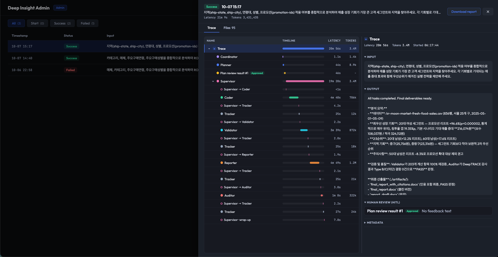
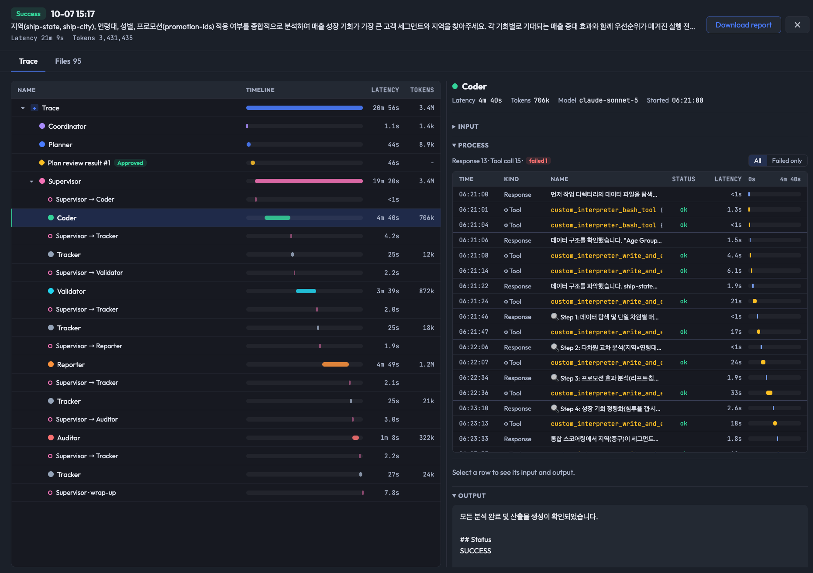

# Deep Insight Ops — Agent Trace & Job Status

> What each job did (agent trace, generated files) and a job status that always settles, even when the browser drops the stream.

**Last Updated**: 2026-10

---

## Problems This Solves

1. **Jobs cut off mid-run stayed "Start" forever.** Every status update depended on the web server reading the response stream to the end. The job's `session_id` was linked only on `workflow_complete`, and the Lambda found the job by that link. A client disconnect ends the generator with `GeneratorExit`, which `except Exception` doesn't catch, so no failure was recorded either.
2. **The dashboard couldn't show what a job did.** Nothing persisted the stream for Web UI jobs, and tool calls (generated code, execution output) never leave the runtime: `STREAM_EVENT_TYPES` filters them out of the response stream.

Fix: the runtime writes its own record of each job to S3 (trace + final status), and the dashboard and Lambda read it from there.

---

## Architecture

```
managed-agentcore/src/utils/event_log.py       — EventLog (compact JSONL) + TraceUploader (S3 uploads)
managed-agentcore/agentcore_runtime.py         — records every graph event, writes job_status.json on every exit path
managed-agentcore/src/utils/strands_sdk_utils.py — agent_start / agent_end per agent invocation
managed-agentcore/src/graph/nodes.py           — plan review (HITL) results
deep-insight-web/ops/lambda/job_complete.py    — settles jobs by job_id, stale-job sweep
deep-insight-web/ops/admin_router.py           — trace / files APIs
deep-insight-web/ops/static/trace-view.js/.css — trace view (side panel)
deep-insight-web/ops/static/files-view.js/.css — files view (side panel)
deep-insight-web/ops/static/jobs.html          — job list + side panel (the only job view)
```

```
Web UI /analyze ──► DynamoDB: Start
     │ payload: prompt, data_directory, job_id
     ▼
AgentCore Runtime
     ├─ after each agent invocation, every 30 s while it changes, and at the end:
     │    s3://…/deep-insight/traces/{job_id}/events.jsonl  ◄── dashboard reads the trace
     └─ at the end (success, error, client disconnect):
          s3://…/deep-insight/fargate_sessions/{session_id}/output/token_usage.json, job_status.json
                                                     │ S3 event
                                                     ▼
                         Lambda: update job by job_id ──► Success / Failed + SNS
EventBridge (15 min) ──► Lambda: Start with no sign of life ──► Failed
```

---

## Trace Recording

The runtime records every graph event **before** the response stream's filter, so tool calls are included even though they never reach the browser. Records are appended to a local JSONL file as they complete, so memory stays flat however long the run is.

### Record kinds

One JSON object per line, in order:

| Kind | Fields |
|------|--------|
| `input` | prompt, data_directory, job_id, request_id |
| `agent_start` | an agent invocation begins: input (the message the agent got) |
| `agent_end` | the invocation ended: error (`None` on success) |
| `text` | agent response text |
| `reasoning` | agent reasoning text |
| `tool_use` | tool, tool_id, input (parsed JSON when possible) |
| `tool_result` | tool, tool_id, output |
| `usage` | model_id and token counts of one agent invocation |
| `plan_review` | plan shown to the user, revision_count |
| `plan_feedback` | how the review ended: decision (approved / revision requested / auto-approved on timeout or max revisions), feedback, revision_count, waited_seconds |

### Compaction

- Consecutive text / reasoning chunks of one agent become one record
- Streamed updates of one tool call collapse to its final input
- String fields are capped at 50,000 chars (`MAX_FIELD_CHARS`)

Measured on an eval run: 6,220 stream events became 39 trace records, about 1–2 MB.

### Uploads

`TraceUploader` puts the log to `deep-insight/traces/{job_id}/events.jsonl`:

- each time an agent invocation finishes
- every 30 s while the log changes (`CHECKPOINT_SECONDS`; one agent can run for minutes, and the record still being written is included without splitting it)
- at least every 5 min, changed or not (`HEARTBEAT_SECONDS`; the trace's last-modified time is the job's heartbeat)
- once more at teardown

About 11 uploads per job at agent boundaries plus the checkpoints (~50 for a 25-minute run), on one worker thread, in order, off the event loop. Upload failures are logged and never fail the job.

### Why the trace is keyed by job_id

The dashboard knows `job_id` from the moment the job starts. `session_id` reaches the job record only when the run ends, and doesn't exist yet while the Coordinator and Planner run. With the job_id key, a running job shows the agents finished so far, and a runtime that dies mid-run (OOM, forced stop) still leaves the trace up to its last finished agent. Runs without a `job_id` (eval harness) use `request_id`.

---

## Job Status

### job_status.json

On every exit path (success, exception, client disconnect) the runtime writes `deep-insight/fargate_sessions/{session_id}/output/job_status.json`, **after** session cleanup, which is when the container uploads the artifacts the Lambda lists:

```json
{
  "job_id": "...",
  "session_id": "...",
  "request_id": "...",
  "status": "Success | Failed",
  "error": "...",
  "ended_at": 1760000000,
  "trace_path": "deep-insight/traces/{job_id}/events.jsonl",
  "output_preview": "first 500 chars of the run's last response",
  "token_usage": null
}
```

The Lambda updates the job **by job_id**, so no session link from the web server is needed. A `job_status.json` with `job_id: null` falls back to the session link (`SessionIdIndex`). The `token_usage.json` trigger stays for older runtimes and skips every file that has the `job_id` key, so each run has exactly one path that settles it. SNS is sent only on a status change.

### Success is final

Three writers record a job's status:

| Writer | When |
|--------|------|
| Runtime → `job_status.json` → Lambda | end of every run |
| Web server (`track_job_failure`) | stream errors |
| Stale-job sweep (EventBridge, 15 min) | jobs still in Start with no sign of life |

None of them replaces a Success with Failed: the web server's and the Lambda's Failed writes are conditional (`attribute_not_exists(#s) OR #s <> :success`) and send no failure mail when the condition stops them, and the sweep only touches jobs still in Start. A Success, on the other hand, replaces an earlier Failed (a sweep that judged a slow job dead).

### Stale-job sweep

| Case | Marked Failed after | Lambda env |
|------|---------------------|-----------|
| Job with a trace | trace not updated for 30 min | `STALE_HEARTBEAT_MINUTES` |
| Job without a trace (older runtimes) | 120 min since start | `STALE_JOB_MINUTES` |

Long runs with several plan revisions and HITL waits keep their heartbeat and stay running.

### Web UI after a dropped stream

When the browser loses the `/analyze` stream (network drop, proxy timeout), the page no longer reports a failed analysis. It polls `GET /jobs/{upload_id}/status` (status and session ID only; error text stays admin-only) and shows the results once the job succeeds, or the failure with the job ID. It keeps checking for 30 minutes after it reads Failed, so a late Success still shows the results.

---

## Admin API

| Route | Purpose |
|-------|---------|
| `GET /admin/api/jobs/{job_id}/trace` | Agent trace (events.jsonl records) |
| `GET /admin/api/jobs/{job_id}/files` | Artifacts and input files |
| `GET /admin/api/jobs/{job_id}/files/{artifacts\|input}/{name}` | File proxy: images and text inline with `CSP: sandbox`, everything else downloads |
| `GET /admin/dashboard/{job_id}` | Redirect to `/admin/dashboard?job={job_id}` (old job page URL) |

All routes require the admin JWT cookie (see [admin-authentication.md](./admin-authentication.md)).

---

## Dashboard UI

The job list (`jobs.html`) is a Langfuse-style table of traces: timestamp, status, input, output, latency, tokens. A row opens a side panel (URL gets `?job=<id>`, Esc closes it) with a report download button and two tabs. The panel width and the tree/detail split are resizable.

- **Trace** (`trace-view.js`)
  - Left half: agents only, in run order — Coordinator, Planner, plan reviews, and the Supervisor with each sub-agent it ran. The Supervisor is split into turns around each delegation (`Supervisor → Coder`, Coder, `Supervisor → Tracker`, …), so its interventions show. Each row has a timeline bar, latency and tokens.
  - Right half, the selected agent: input, output, then its process as a waterfall (one row per response or tool call with offset from the agent's start, status, duration and a bar on the agent's timeline; a failed-only filter; the selected row opens below with input / output tabs), and metadata.
  - A running job refreshes every 15 s and marks its running agents. A failed job shows its error in the header.
- **Files** (`files-view.js`): input data, result documents (report first), generated images, and every generated file (collapsed).





Jobs that ran before the runtime recorded traces show files only. Traces from before `agent_start` was recorded fall back to implicit invocations and show "not recorded" as the input.

---

## Deploy Order

Recommended: `bash ops/deploy_ops.sh` → `bash deploy.sh` → `uv run 01_create_agentcore_runtime_vpc.py` (managed-agentcore). Every order is safe:

| Lambda | Runtime | Behavior |
|--------|---------|----------|
| new | new | `job_status.json` settles the job (success and failure) |
| new | old | `token_usage.json` settles successful jobs via the session link, as before; no trace |
| old | new | `token_usage.json` (written by successful runs only) settles successful jobs via the session link; failed runs write no `token_usage.json`, so they can't be recorded as Success |
| old | old | unchanged |

`deploy_ops.sh` applies the Lambda role policy and the function environment on every run, so existing deployments get the trace read permission (`deep-insight/traces/*`) and the `S3_BUCKET_NAME` the heartbeat check needs.

---

## Tests

```bash
cd managed-agentcore && .venv/bin/python -m pytest tests/      # event log, entrypoint exit paths, plan review results
cd deep-insight-web && python -m pytest ops/tests/              # Lambda (moto), job tracker, admin files API
```

`ops/tests/` needs `moto`, `pytest`, `httpx`.
