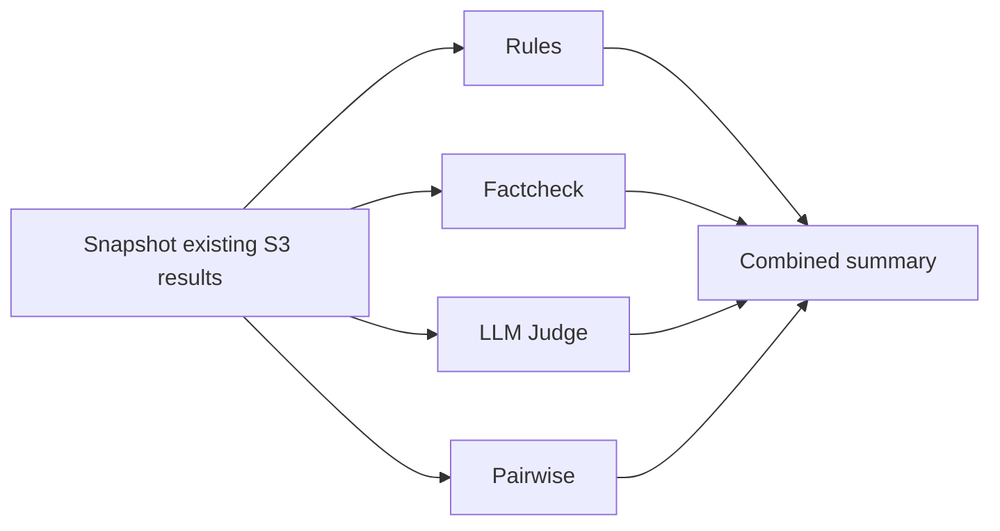

# Parallel evaluation of existing results

The **Eval harness** workflow evaluates reports that already exist. It does not call AgentCore, generate reports, deploy code, or switch runtime models.



The four matrix jobs have the same dependency, `prepare`, with `max-parallel: 4` and `fail-fast: false`. Available GitHub runner capacity determines when each job starts. An evaluator failure does not cancel the other evaluators. The final summary runs even on failure and treats a missing result as a failure.

## One-time GitHub/AWS setup

1. Merge `.github/workflows/eval-harness.yml` into the repository's default branch.
2. Create the GitHub environment **eval-harness**, restrict its allowed branches, and configure its reviewers as appropriate for your repository.
3. Configure an AWS OIDC role for that repository/environment. Restrict its trust to audience `sts.amazonaws.com` and subject `repo:OWNER/REPOSITORY:environment:eval-harness`. Long-lived AWS keys are not used.
4. Set these repository or environment variables:

| Variable | Purpose |
|---|---|
| `EVAL_AWS_ROLE_ARN` | OIDC role used by the preparation and evaluator jobs |
| `EVAL_AWS_REGION` | Region, defaults to us-west-2 |
| `EVAL_RESULTS_S3_URI` | Private output prefix; can instead be supplied for each run |

The role needs:

- `s3:ListBucket` limited to the candidate/baseline prefixes, and `s3:GetObject` for those files and the answer key.
- `s3:PutObject`, `s3:GetObject`, and `s3:GetObjectVersion` for the dedicated output prefix, including the input snapshot. The latter allows all jobs to consume the same pinned S3 version.
- `bedrock:InvokeModel` for the selected inference profile and its permitted destination foundation models. A global inference profile can route to multiple regions.
- Corresponding KMS permissions if your S3 bucket uses a customer-managed key.

No runtime invocation, IAM administration, deployment, SNS publishing, or S3 deletion permission is needed. Keep the buckets private with S3 Block Public Access enabled.

## Required inputs

Choose **Actions → Eval harness → Run workflow**.

| Input | Contents |
|---|---|
| candidate_s3_uri | An existing candidate run/session prefix |
| baseline_s3_uri | An existing baseline run/session prefix for the same request and dataset |
| facts_s3_uri | One independently verified JSON answer key |
| scenario | A name from config/scenarios.yaml; determines the request and CSV used for rule checks |
| results_s3_uri | Private output prefix, or use EVAL_RESULTS_S3_URI |
| model_id | Bedrock inference profile for all three reader-based evaluators |

A run/session prefix can contain `artifacts/final_report_with_citations.docx`, citations, calculation metadata, validation results, execution JSON and optional run metadata. A prefix pointing directly at the artifacts folder also works. Use complete runs, not folders still being written. If run/config metadata names another scenario, evaluation rejects it. Legacy sessions without that metadata rely on your explicit scenario selection. A custom dataset/request needs its own scenario.

The baseline is an earlier result you intentionally select, not an automatically generated reference or a copy of the candidate. Baseline reports and verified facts are **not included** with this change.

## Factcheck answer key

Start with `config/facts.example.json`. It is intentionally marked `example: true` and is rejected as evaluation input. Supply real values and remove that marker only after verifying the facts independently.

```json
{
  "version": 1,
  "scenario": "jungle_market_simple",
  "facts": [
    {
      "id": "total_revenue",
      "statement": "Total revenue in USD over the complete dataset after removing exact duplicate rows",
      "expected": 12345.67,
      "absolute_tolerance": 0.01,
      "relative_tolerance": 0,
      "required": true
    }
  ]
}
```

The number above illustrates the schema; it is not a dataset answer.

Each fact has a unique ID, a statement specifying scope/period/denominator/unit, and a finite numeric or nonempty text expected value. Numeric tolerances are explicit and default to zero. Use percentages as 0–100 when the report prints percent, and expand magnitude suffixes such as millions in the expected value. Keys support up to 64 facts.

Factcheck asks the model to extract the report's value and an exact supporting excerpt **without showing the expected answer to the model**. Python checks the excerpt against the report, checks the extracted value against the excerpt, and then compares it to the answer key. A wrong found claim or missing required fact fails. An empty check cannot pass. Optional facts may be absent, but any found optional fact must still be correct. This checks the supplied facts; it is not exhaustive verification of every report claim.

## Evaluators and pass criteria

| Evaluator | Behavior |
|---|---|
| Rules | Calls the existing grade.py/graders unchanged; uses the scenario's original core_pass thresholds and source CSV |
| Factcheck | Semantic claim extraction plus deterministic answer-key comparison, with evidence validation |
| LLM Judge | Scores the dimensions/weights in config/judge_rubric.json; default weighted score ≥3.5/5 and each dimension ≥2 |
| Pairwise | Two blind comparisons with candidate/baseline positions reversed; candidate win or tie passes only when both orders agree |

Position disagreement is **inconclusive**, not a candidate win. Truncated output, invalid JSON, invalid scores, fabricated evidence and model/API failures produce an error and fail the corresponding job. Judge scores 3–5 need a real report excerpt; an absent criterion may receive only score 1–2 without a quote. These are text-only readers: DOCX body and table text are read, references are excluded, and chart images are not inspected. The model judges provide assessments, not proofs of source-data correctness. Rubric thresholds require calibration on your real baseline set.

## Results and privacy

Preparation copies supported input files into one private S3 snapshot. Every evaluator verifies the same SHA-256 and consumes the same S3 version (or checks its ETag on an unversioned bucket). Generated Python/shell attachments are never executed.

Detailed results, evidence quotes, model responses, usage, model ID and prompt hashes remain under:

```text
<results-prefix>/actions/<github-run-id>-<attempt>/inputs.zip
<results-prefix>/actions/<github-run-id>-<attempt>/results/{rules,factcheck,judge,pairwise}.json
```

GitHub artifacts contain only the snapshot location/checksum manifest and sanitized aggregate scores, retained for seven days. Raw reports, facts, prompts, excerpts and exception details are not uploaded to GitHub. The role and environment must allow access only to the intended evaluation data. Configure S3 lifecycle retention separately for the private snapshots and detailed results.

Exit codes: 0 = pass; 1 = failed assessment; 2 = evaluation error. The final **Evaluation summary** job fails if any of the four evaluators fails/errors/is missing.

## Local use

Run from `eval-harness/`:

```bash
pip install -r requirements-ci.txt
python ci.py evaluate --kind rules --scenario jungle_market_simple \
  --candidate-dir /path/to/candidate \
  --out /tmp/rules.json --summary-out /tmp/rules/summary.json
python ci.py evaluate --kind factcheck --scenario jungle_market_simple \
  --candidate-dir /path/to/candidate --facts /path/to/verified-facts.json \
  --out /tmp/factcheck.json --summary-out /tmp/factcheck/summary.json
python ci.py evaluate --kind judge --scenario jungle_market_simple \
  --candidate-dir /path/to/candidate \
  --out /tmp/judge.json --summary-out /tmp/judge/summary.json
python ci.py evaluate --kind pairwise --scenario jungle_market_simple \
  --candidate-dir /path/to/candidate --baseline-dir /path/to/baseline \
  --out /tmp/pairwise.json --summary-out /tmp/pairwise/summary.json
```

The last three commands call Bedrock and incur inference charges. Rules do not call a model. Override `--model-id` and `--region` as needed. Run the full test suite with the existing `requirements.txt` environment and `python -m pytest -q`; CI-only dependencies intentionally omit the agent frameworks used by the older L0 tests.

